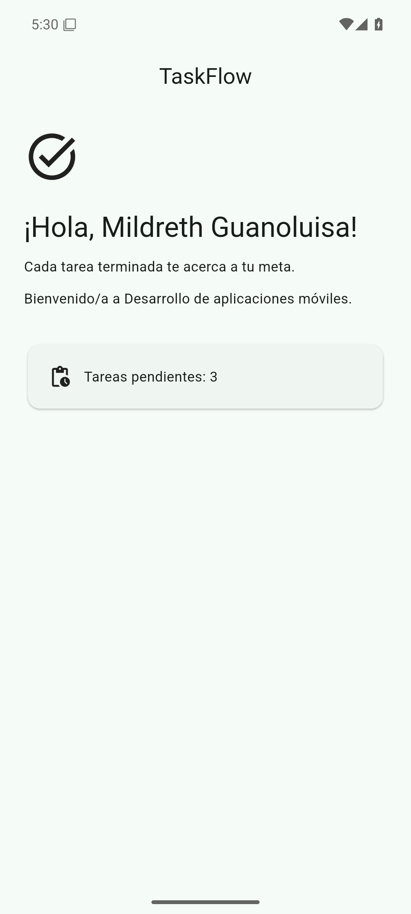

# TaskFlow — Sesión 1

Pantalla de bienvenida de **TaskFlow**, la app de tareas del curso de Flutter. Esta ficha describe el código que ya está en `main` (`5578e526b47aa8fad030ce4c4f51dfc64e9d7b33`, `feat: crear pantalla de bienvenida`). La guía original del aula sigue en [LEEME.md](LEEME.md), sin cambios. La procedencia de la captura está en [EVIDENCIAS.md](EVIDENCIAS.md).

## Objetivo

Mostrar una pantalla fija de bienvenida: el nombre de la app, el nombre de la estudiante, el mensaje del curso y un contador de tareas que no cambia.

## Qué hace esta versión

Todo vive en `lib/main.dart`. `TaskFlowApp` y `WelcomeScreen` son `StatelessWidget`: no hay `setState`, botones ni navegación.

- `MaterialApp` con Material 3, `debugShowCheckedModeBanner: false` y semilla `Color(0xFF1F6F5B)`. Esa paleta no es el índigo del ejemplo guiado; `test/widget_test.dart` lo comprueba.
- Barra superior centrada con el título `TaskFlow` y el ícono `Icons.task_alt`.
- Saludo `¡Hola, Mildreth Guanoluisa!`.
- Mensaje `Cada tarea terminada te acerca a tu meta.`
- Texto `Bienvenido/a a Desarrollo de aplicaciones móviles.`
- Tarjeta fija `Tareas pendientes: 3`, con el ícono `Icons.pending_actions`.

La pantalla no cambia al tocarla. En esta sesión no existen «Agregar tarea» ni «Completar una tarea».

## Cómo ejecutarla y cómo comprobarla

`pubspec.yaml` no declara scripts propios. El paquete se llama `taskflow`, versión `1.0.0+1`, `publish_to: none`, SDK `^3.13.7`, con `flutter`, `cupertino_icons`, `flutter_test` y `flutter_lints`. `analysis_options.yaml` incluye `package:flutter_lints/flutter.yaml` y documenta `flutter analyze`.

En la carpeta de `pubspec.yaml`:

```bash
flutter pub get
flutter devices
flutter run
```

```bash
dart format lib
flutter analyze
flutter test
```

`flutter analyze` debe terminar sin problemas. El test de widget busca el saludo, el mensaje, el curso, `Tareas pendientes: 3` y comprueba que no aparezca `Agregar tarea`.

## Estructura

```text
.
├── LEEME.md                         # guía original de la sesión
├── README.md                        # esta ficha
├── EVIDENCIAS.md                    # entorno real de la captura
├── docs/evidencias/
│   ├── sesion-01-bienvenida.png
│   └── sesion-01-ejecucion.mp4
├── lib/main.dart                    # TaskFlowApp y WelcomeScreen
├── test/widget_test.dart
├── pubspec.yaml
├── analysis_options.yaml
└── android/ ios/ linux/ macos/ web/ windows/
```

El identificador Android es `com.example.taskflow` (`android/app/build.gradle.kts`).

## Evidencia

Captura del emulador **Android 15 (API 35)**, AVD `taskflow_api35`, con **Flutter 3.47.9** en un entorno remoto de prueba. No es el teléfono físico de la estudiante.



El video dura 10,9 s (H.264, 1080×2400) y muestra la misma bienvenida estática: **Mildreth Guanoluisa** y **Tareas pendientes: 3**. El enlace es la ruta del archivo.

[Video de la ejecución en el emulador](docs/evidencias/sesion-01-ejecucion.mp4)
